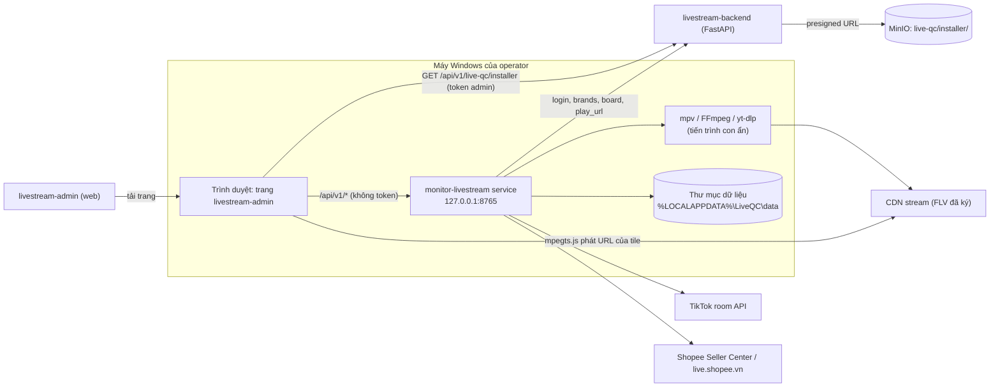
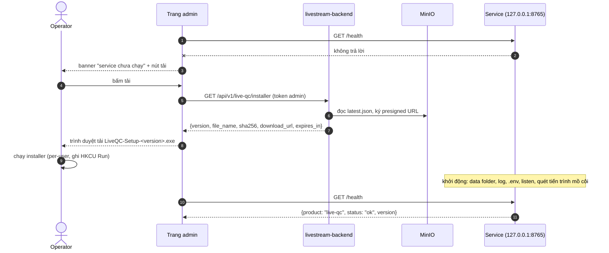
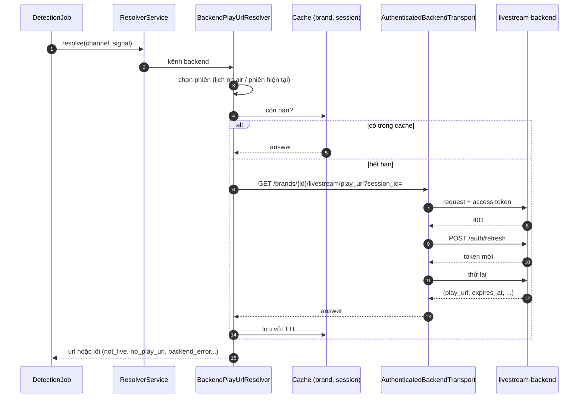

# Tổng quan hệ thống Monitor Livestream

Tài liệu này dành cho developer mới. Đọc xong bạn sẽ biết hệ thống làm gì, gồm những phần nào, các phần nói chuyện với nhau ra sao, dữ liệu nằm ở đâu, và hệ thống được xây qua từng phase như thế nào.

Nguồn chính xác nhất vẫn là code và contract. Khi tài liệu này khác code, làm theo code:

- Contract API: [contract/live-qc-api.md](contract/live-qc-api.md)
- OpenAPI sinh từ code: [openapi/live-qc.json](openapi/live-qc.json)
- README: [../README.md](../README.md)

> **Về tên gọi.** Sản phẩm trước đây tên là "Live QC", nay gọi là **Monitor Livestream**. Một số định danh kỹ thuật cố ý giữ tên cũ để các bản đã cài trên máy operator và hai repo kia vẫn chạy được: `product: "live-qc"` trong `/health`, thư mục dữ liệu `LiveQC`, file `live-qc-service.exe`, installer `LiveQC-Setup-<version>.exe`, các route `/dashboard/live-qc/...` bên admin, module `live_qc` và route `/api/v1/live-qc/installer` bên backend. Khi viết code, giữ nguyên các định danh này.

---

## 1. Tổng quan

Monitor Livestream giúp operator theo dõi nhiều livestream TikTok và Shopee cùng lúc. Với mỗi kênh được theo dõi, hệ thống:

1. Tìm URL stream hiện tại của kênh (TikTok room API, Shopee Seller Center, hoặc `play_url` từ livestream-backend).
2. Mở stream bằng mpv (chạy ẩn) hoặc FFmpeg và kiểm tra xem **có khung hình video thật sự đến hay không**. Kênh chỉ được coi là `live` khi đã nhận được frame, không phải chỉ vì nền tảng báo "đang live".
3. Cập nhật trạng thái từng kênh (`live`, `offline`, `no_signal`, `unknown`...), lưu frame mới nhất để xem trước.
4. Hiển thị các kênh đang live trên **live wall** trong trình duyệt: lưới video phát trực tiếp bằng `mpegts.js`.

Đặc điểm triển khai:

- Service chạy **trên chính máy Windows của operator**, chỉ lắng nghe ở `127.0.0.1` (mặc định cổng `8765`). Không có bản deploy lên server.
- Operator cài service bằng một **installer per-user** (`LiveQC-Setup-<version>.exe`), tải về qua livestream-backend. Cài không cần quyền admin, service tự chạy khi đăng nhập Windows.
- Giao diện nằm trong **livestream-admin** (React). Trang admin mở trong trình duyệt và gọi thẳng service ở `http://127.0.0.1:8765`.

Repo này còn chứa công cụ Python cũ (`livestream_qc/`, `web/`, `server.py`...). Đó là bản tham chiếu mà service TypeScript được port từ đó. Bản Python không được đóng gói hay phát hành; nó sẽ bị gỡ ở Phase 7.

---

## 2. Kiến trúc 3 repo

| Repo | Công nghệ | Vai trò |
| --- | --- | --- |
| **monitor-livestream** (repo này) | NestJS 11 + Fastify, TypeScript, Node 24 | Service local: lưu kênh, resolve stream, phát hiện live, live wall API. Là **provider** của contract API. Đóng gói thành installer Windows. |
| **livestream-admin** | React 18 + TypeScript + MUI | Giao diện: các trang dưới `/dashboard/live-qc/...` (module `src/modules/live-qc/`). Là **consumer**: sinh type từ `docs/openapi/live-qc.json`, không tự viết type tay. |
| **livestream-backend** | FastAPI | Nguồn dữ liệu brand Shopee Open API, lịch live, `play_url`. Có thêm module `app/modules/live_qc/` để phát link tải installer. |

Các đường giao tiếp:

1. **Trình duyệt (trang admin) → service local** qua `http://127.0.0.1:8765/api/v1`. Không gửi bearer token của admin; service dùng một axios instance riêng không có interceptor token.
2. **Service → livestream-backend** bằng **tài khoản admin riêng** mà operator đăng nhập trên trang "Kết nối backend". Service gọi `/api/v1/auth/login`, `/auth/refresh`, `/brands`, `/live-monitor/board`, `/brands/{brand_id}/livestream/play_url`.
3. **Service → TikTok / Shopee** trực tiếp từ máy operator: TikTok room API, Shopee Seller Center (`banhang.shopee.vn`), `live.shopee.vn`.
4. **Service → tiến trình con**: mpv (detector mặc định, chạy ẩn), FFmpeg (detector thay thế), yt-dlp (fallback của TikTok). Mọi tiến trình con đều chạy ẩn, không mở cửa sổ console.
5. **Trang admin → livestream-backend** (với token admin bình thường) để lấy link tải installer: `GET /api/v1/live-qc/installer`.
6. **Trình duyệt → CDN của nền tảng**: live wall phát URL FLV đã ký mà service trả về; video đi thẳng từ CDN vào trình duyệt, không đi qua service.



---

## 3. Các module của service

Code nằm trong [../src/](../src/). Quy ước chung:

- Mỗi module có `index.ts`; module khác chỉ import qua file này.
- Phân lớp controller → service → repository. Controller không chứa logic nghiệp vụ.
- **Leaf module** (`detection-state`, `settings`, `processes`, `shopee`) không import module tính năng nào khác. Khi tầng dưới cần kích hoạt hành vi ở tầng trên thì dùng port: `DetectionControl` nằm trong `detection-state`, `detection` đăng ký hàm stop vào đó, còn `shops` gọi nó khi xoá hoặc đổi tên kênh.
- Lỗi nghiệp vụ là `DomainException` có mã ổn định; một bảng duy nhất ánh xạ mã sang HTTP status.

### 3.1 `src/modules/`

| Module | Việc chính |
| --- | --- |
| [`health`](../src/modules/health/) | `GET /health` trả `{product: "live-qc", status, version}`. Admin dùng nó để biết service có chạy không, có đúng chương trình không, và có cần cập nhật không. |
| [`shops`](../src/modules/shops/) | Kênh local trong `shops.json` và cookie Seller Center trong `shopee_cookies.json`: đọc, thêm, sửa, xoá; quy tắc key/label giống bản Python; kiểm tra field theo nền tảng (`ShopFieldsValidator`). Gộp thêm kênh backend vào danh sách. `ChannelDirectory` là read model mà các module khác dùng để đọc kênh và dựng resolve request. |
| [`shopee`](../src/modules/shopee/) | Leaf. `SellerCenterClient` (kiểm tra login bằng cookie, `sessionInfo`, tra phiên đang live), allow-list link Shopee (`shopee.vn`, `shp.ee`), quy tắc cookie, quy tắc "Seller Center đang lỗi" khác với "cookie bị từ chối". |
| [`backend`](../src/modules/backend/) | Đăng nhập livestream-backend bằng tài khoản admin, refresh token, lưu `backend_session.json`, vòng đồng bộ brands và board, trạng thái đã che (`BackendStatus`). `BackendLoginState` giữ "epoch" của lần đăng nhập. `BackendPlayUrlGateway` là cổng gọi `play_url`. |
| [`resolvers`](../src/modules/resolvers/) | Kênh → URL stream. `ResolverService` chọn resolver theo kênh: `TikTokResolver` (room API, fallback yt-dlp), `ShopeeSellerCenterResolver`, `BackendPlayUrlResolver` (có cache). `ResolveDeadline` cho mỗi lần resolve một ngân sách thời gian chung; resolve có thể huỷ bằng signal. |
| [`players`](../src/modules/players/) | Tìm mpv (`PlayerLocator`, cùng thứ tự tìm với bản Python, bản bundled đứng đầu), đọc khoá Uninstall trong registry (`UninstallRegistry`), dựng tham số dòng lệnh mpv, client JSON IPC qua named pipe (`MpvIpcClient`). |
| [`processes`](../src/modules/processes/) | Leaf. `ChildProcessRegistry` khởi chạy và theo dõi tiến trình con sống lâu, ghi danh sách vào `runtime/children.json`, kill khi tắt service, dọn tiến trình mồ côi sau khi bind cổng. `ToolLocator` tìm FFmpeg và yt-dlp. |
| [`detection-state`](../src/modules/detection-state/) | Leaf. `DetectionStateStore` giữ snapshot phát hiện của từng kênh trong bộ nhớ; `DetectionControl` là port stop/rename. |
| [`detection`](../src/modules/detection/) | Job phát hiện live cho từng kênh: `DetectionJobManager`, `DetectionJob`, detector `MpvFrameDetector` và `FfmpegFrameDetector`, quy tắc verdict, cookie parking, `StreamRefresher` (resolve lại cho live wall). Route `detection/start`, `detection/stop`, `frame`. |
| [`monitor`](../src/modules/monitor/) | `MonitorSupervisor`: giữ đúng một job cho mỗi kênh được chọn (theo nền tảng và danh sách key). Route `/monitor`. |
| [`settings`](../src/modules/settings/) | Leaf. `LayoutSettingsStore` đọc/ghi `mpv_layout.json` theo định dạng, giá trị mặc định và cách kẹp giá trị của bản Python. |
| [`layout`](../src/modules/layout/) | `GET/PUT /settings/layout`: trả settings, danh sách detector/aspect và các tile. `screen`, `area`, `rows`, `columns` hiện vẫn là giá trị mẫu (chờ Phase 4b). |
| [`wall`](../src/modules/wall/) | `GET /wall` (tile của các job đang chạy, kèm URL stream gần nhất) và `POST /wall/:key/refresh` (resolve URL mới). |

### 3.2 `src/common/`, `src/config/`, `src/openapi/`

| Thư mục | Nội dung |
| --- | --- |
| `common/constants` | Hằng số toàn app (cổng, origin, tên thư mục dữ liệu và log), bảng mã lỗi `ErrorCode`, bảng ánh xạ mã → HTTP status, bảng thông báo lỗi tiếng Việt. |
| `common/enums` | `Platform`, `LiveStatus`, `JobState`, `ReasonCode`, `Detector`, `ShopSource`. |
| `common/exceptions`, `filters`, `dtos`, `decorators` | `DomainException`, `AllExceptionsFilter` trả envelope `{detail, error: {code, message, request_id}}` giống livestream-backend, DTO lỗi cho OpenAPI, decorator khai báo lỗi của từng route. |
| `common/hooks` | `localRequestHook`: hook `onRequest` của Fastify chặn `Host` không phải loopback và request khác origin (xem mục 6). |
| `common/pipes`, `validation` | `RejectNullFieldsPipe` cho `PUT /settings/layout`, các helper kiểm tra đầu vào. |
| `common/fs` | Ghi JSON nguyên tử (`writeJsonFileAtomic`: file tạm rồi rename, thử lại khi Windows báo file đang bận), `replaceFileWith`, phân loại lỗi file. |
| `common/http` | `getJson` có giới hạn kích thước phản hồi. |
| `common/process` | `spawnHidden`, `execFileHidden`, `runHidden`, `killProcessTree`, `findTool`, truy vấn image và thời điểm tạo của tiến trình. |
| `common/concurrency` | `Semaphore`, `AsyncLock`, `withTimeout`, `abortableSleep`, `raceAbort`. |
| `common/logging` | Ghi log ra file khi chạy bản đóng gói, giới hạn 5 MB và xoay vòng, log lỗi fatal trước khi thoát. |
| `common/utils` | `safeError` và các hàm che (mask) bí mật/URL, `retryDelayMs`, helper giá trị kiểu Python, chuỗi nguyên nhân lỗi, nhận diện lỗi mạng. |
| `config/` | `appConfig` (`QC_PORT`, `ALLOWED_ORIGINS`, version), `resolveDataDir()`, `DataDirModule` (token `DATA_DIR`), đường dẫn trong `runtime/`. |
| `openapi/` | Dựng tài liệu Swagger và script xuất `docs/openapi/live-qc.json`. |

---

## 4. Các luồng chính

### 4.1 Cài đặt và khởi động

1. Operator mở một trang Monitor Livestream trong admin. Banner gọi `GET /health` định kỳ. Nếu gọi lỗi, hoặc trả lời mà không có `product: "live-qc"` (một chương trình khác đang giữ cổng), banner báo service chưa chạy và hiện nút tải installer. Nếu `version` thấp hơn `LIVE_QC_MIN_SERVICE_VERSION` trong code admin thì banner báo cần cập nhật.
2. Nút tải gọi livestream-backend `GET /api/v1/live-qc/installer` (xem 4.10), trình duyệt tải `LiveQC-Setup-<version>.exe`.
3. Installer (Inno Setup, [../scripts/package/installer.iss](../scripts/package/installer.iss)) cài per-user vào `%LOCALAPPDATA%\Programs\LiveQC`, không cần quyền admin. Bản build chưa ký số, nên Windows SmartScreen sẽ cảnh báo ("More info" → "Run anyway").
4. Installer ghi giá trị `LiveQC` vào `HKCU\Software\Microsoft\Windows\CurrentVersion\Run`, nên service chạy mỗi lần đăng nhập Windows. Đây là tiến trình đăng nhập, **không phải Windows Service**: service chạy ở session 0 không mở được cửa sổ mpv trên desktop.
5. Khi nâng cấp, installer dừng service của **chính user đó** (`taskkill` lọc theo `USERNAME`), chờ tối đa 5 s cho tiến trình thoát rồi mới thay file. Khi gỡ cài đặt cũng làm như vậy. Thư mục dữ liệu được giữ lại, trừ khi user đồng ý xoá.
6. Khi chạy, [../src/main.ts](../src/main.ts):
   - xác định thư mục dữ liệu: bản đóng gói (Node SEA) dùng `%LOCALAPPDATA%iveqcdata`, chạy từ source dùng thư mục gốc repo;
   - bản đóng gói chuyển stdout/stderr vào `logs/live-qc.log` (nếu không ghi được thì dùng thư mục temp) và bắt lỗi fatal;
   - đọc `.env` trong thư mục dữ liệu (`QC_PORT`, `ALLOWED_ORIGINS`, `AUTO_LIVES_BACKEND_URL`);
   - dựng app Fastify, gắn hook bảo vệ, Swagger ở `/docs` (bản đóng gói lấy Swagger UI từ thư mục `swagger-ui` cạnh file exe);
   - `listen` ở `127.0.0.1:<QC_PORT>`. Nếu cổng đã bị chiếm thì instance thứ hai log lỗi rồi thoát, nên mỗi máy chỉ có một service;
   - **sau khi** đã giữ được cổng mới chạy `ChildProcessRegistry.sweepOrphans()`: kill những mpv/FFmpeg mà lần chạy trước bị crash bỏ lại. Một pid chỉ bị kill khi cả image lẫn thời điểm tạo khớp với bản ghi. Instance thứ hai không bao giờ đụng vào player của instance đầu;
   - bật xoay vòng log (cũng chỉ instance giữ cổng mới làm).



### 4.2 Thêm và sửa kênh local

Kênh local nằm trong `shops.json`, mỗi máy có danh sách riêng.

**TikTok:**

1. `POST /shops` với `{platform: "tiktok", username}` (dấu `@` ở đầu bị bỏ), có thể kèm `live_url` là URL http(s) bất kỳ.
2. Key sinh từ username, nên đổi username nghĩa là đổi key. Trùng key với kênh khác thì trả `409 SHOP_ALREADY_EXISTS`.
3. Service ghi `shops.json` theo đúng định dạng của bản Python (thứ tự field, thụt lề, line ending), giữ nguyên các field nó không quản lý.

**Shopee (cookie Seller Center):**

1. Operator dán header `cookie` của một request bất kỳ tới `banhang.shopee.vn`. Service chỉ giữ `SPC_SC_SESSION`. Giá trị có ký tự ngoài ASCII in được thì trả `400`, và thông báo lỗi không lặp lại giá trị cookie.
2. Trước khi lưu bất cứ thứ gì, service kiểm tra cookie bằng `GET https://banhang.shopee.vn/api/v2/login/`:
   - cookie bị từ chối → `400 BAD_REQUEST`, `detail` nói cookie bị từ chối;
   - Seller Center không trả lời được (lỗi mạng, timeout, 5xx, 429, hoặc 200 mà body không phải JSON) → vẫn là `400`, nhưng `detail` nói Seller Center không liên lạc được. Không coi đây là cookie sai.
3. Login thành công thì điền `user_id`, `shop_id`; `name` mặc định là username Seller Center, nếu không có thì dùng `user_id`. Nếu người dùng tự nhập `user_id` thì nó phải khớp với kết quả login.
4. Cookie lưu trong `shopee_cookies.json` theo `user_id`. API không bao giờ trả cookie ra, chỉ có cờ `cookie_set`.
5. `live_url` của Shopee chỉ nhận https trên `shopee.vn` hoặc `shp.ee` (kể cả subdomain), cùng allow-list mà resolver dùng.
6. Sửa kênh (`PUT /shops/:key`): field bỏ trống thì giữ nguyên, `null` thì xoá field tuỳ chọn, chuỗi rỗng `''` bị từ chối. Không gửi `cookie` thì giữ cookie đang lưu. Cookie không còn kênh nào dùng sẽ bị xoá.
7. Xoá hoặc đổi tên kênh sẽ dừng job của key cũ và kill player của nó **trước khi** request trả lời (qua port `DetectionControl`).

Kênh backend (`source: "backend"`) chỉ đọc: sửa hoặc xoá trả `409 BACKEND_SHOP_READ_ONLY`.

### 4.3 Đồng bộ với livestream-backend

1. Trên trang "Kết nối backend", operator nhập email và mật khẩu của một tài khoản **admin hoặc super_admin**. Admin gọi `POST /backend/login`.
2. Service gọi `POST <AUTO_LIVES_BACKEND_URL>/api/v1/auth/login`. Tài khoản có vai trò khác bị từ chối với `400 BACKEND_LOGIN_FAILED`: với vai trò khác, backend chỉ trả brand của chính họ nên danh sách sẽ thiếu mà không ai biết. Mật khẩu không bao giờ được lưu. Cặp token lưu vào `backend_session.json` cùng địa chỉ backend; một phiên đăng nhập lưu cho backend khác sẽ bị bỏ qua.
3. Mỗi lần đăng nhập mới tạo ra một **login epoch** mới. Job của kênh backend thuộc về epoch mà nó được khởi động; khi epoch đổi (logout, login mới, refresh bị từ chối), job đó tự dừng trong vòng 30 s.
4. Vòng đồng bộ chạy mỗi 30 s và quyết định có cần đọc không:
   - `GET /api/v1/brands` mỗi 10 phút. Brand có `is_connect_shopee` thành kênh backend với key `shopee_api_<10 ký tự hex đầu của sha1(brand_id)>`, label là tên brand. Các kênh này chỉ nằm trong bộ nhớ, không bao giờ ghi vào `shops.json`;
   - `GET /api/v1/live-monitor/board?date=<hôm nay>` mỗi 2 phút, và ngay khi sang ngày mới. Kết quả là lịch live hôm nay của từng brand.
5. Gặp `401` thì service gọi `/auth/refresh` rồi thử lại. Lần thử đầu, thời gian chờ refresh và lần thử lại dùng chung ngân sách 25 s.
6. Đọc thất bại thì giữ danh sách tốt gần nhất, `error` mang lý do đã che, lần thử sau chờ 60 s, rồi gấp đôi dần tới tối đa 600 s (`Retry-After` của backend thay cho mốc 60 s nếu có, vẫn bị giới hạn ở 600 s).
7. `POST /backend/sync` đọc cả hai ngay lập tức. `POST /backend/logout` chỉ xoá file phiên trên máy, không thu hồi token phía backend.
8. Khi chưa đăng nhập, service không gọi backend lần nào và không liệt kê kênh backend nào.

### 4.4 Resolve stream

Mỗi lần resolve có một ngân sách (mặc định 25 s) dùng chung cho mọi request HTTP bên trong, kể cả từng bước redirect. Dừng job thì mọi request đang chạy bị huỷ, kết quả là `cancelled`: không có verdict, không log, không cache.

**TikTok** ([../src/modules/resolvers/tiktok/](../src/modules/resolvers/tiktok/)):

1. Gọi room API `https://www.tiktok.com/api-live/user/room/?...&uniqueId=<username>`.
2. Chọn stream theo chất lượng từ `origin` xuống `ld`, ưu tiên FLV.
3. Nếu room API thất bại thì chạy yt-dlp ẩn, với **một ngân sách riêng**, để room API dùng hết thời gian cũng không làm fallback bị đói. yt-dlp được tìm trong `<data>/tools` rồi đến `PATH`, và tối đa 2 tiến trình yt-dlp chạy cùng lúc. yt-dlp báo "not currently live" thì kết quả là `offline`.

**Shopee qua cookie** ([../src/modules/resolvers/shopee/](../src/modules/resolvers/shopee/)):

1. Lấy session id: từ `live_url` dạng share link (theo redirect bằng tay, kiểm tra allow-list ở từng bước), nếu không có thì tra `https://live.shopee.vn/api/v1/shop_page/live/ongoing?uid=<user_id>`.
2. Gọi `https://banhang.shopee.vn/api/supply/lm/sellercenter/realtime/dashboard/sessionInfo?sessionId=<id>` kèm cookie, nhận `sessionStreamingUrl`: một URL FLV đã ký, có hạn dùng. URL được lấy mới ở mỗi lần resolve; mpv/FFmpeg đọc nó mà không cần cookie.
3. Một tài khoản Seller Center chỉ thấy phiên của shop mình (`seller_center_no_access`).

**Kênh backend (Shopee Open API)** ([../src/modules/resolvers/backend/](../src/modules/resolvers/backend/)):

1. Chọn phiên: lịch đang "on air" (từ 15 phút trước giờ bắt đầu đến 30 phút sau giờ kết thúc dự kiến), nếu không có thì phiên hiện tại của brand (`session_id` rỗng).
2. Gọi `GET /api/v1/brands/{brand_id}/livestream/play_url?session_id=<id>`. Backend kiểm tra brand scope và chỉ trả `play_url` (HTTP-FLV đã ký, có `expires_at`), không bao giờ trả push key hay access token.
3. **Cache theo brand và phiên**, vì mỗi lần gọi `play_url` tốn backend một lần gọi Shopee API:
   - đang live: dùng lại 60 s, nhưng không quá thời điểm hết hạn trừ 60 s;
   - chưa live mà đang có lịch: 60 s; không có lịch: 600 s;
   - lỗi liên tiếp: chờ 30 s, 60 s, 120 s, rồi 300 s.
4. Phiên tạo từ app điện thoại có thể không có `play_url` (`no_stream_url`).



### 4.5 Phát hiện live

Mỗi kênh có tối đa một job. `POST /shops/:key/detection/start` tạo job, hoặc trả trạng thái của job đang chạy. `POST /shops/:key/detection/stop` dừng job theo key, kể cả khi kênh không còn tồn tại.

Vòng lặp của một job ([../src/modules/detection/services/detection-job.ts](../src/modules/detection/services/detection-job.ts)):

1. Đọc kênh như hiện tại. Kênh đã mất, hoặc login epoch của kênh backend đã đổi, thì job kết thúc.
2. Kiểm tra công cụ của detector đang chọn (mpv hoặc FFmpeg). Thiếu công cụ thì job chuyển sang `job_state: error`, `reason_code: tool_missing`, và ngừng thử lại.
3. `job_state: retrying`, tăng `attempts`, dựng resolve request mới. Cookie lưu sau khi job đã chạy vẫn được dùng ở lần thử kế tiếp.
4. Resolve thất bại là một "miss" với verdict tương ứng (bảng trong contract), rồi chờ theo nền tảng:

   | Sau khi | TikTok | Shopee |
   | --- | --- | --- |
   | nền tảng nói không live (`offline`) | 20 s | 60 s |
   | resolve thất bại kiểu khác | 5 s | 15 s |
   | mở được stream nhưng không có frame (`no_signal`) | 3 s | 3 s |
   | mất frame hoặc player thoát | 3 s | 3 s |

5. Có URL thì chạy detector (`job_state: checking_image`). Frame đầu tiên phải đến trong 20 s.
6. Có frame thì `status: live`, `job_state: playing`, và cứ 30 s kiểm tra lại. Stream đứng hình, player bị đóng, hoặc URL hết hạn thì quay về `retrying` mà **không ghi verdict**, nên một kênh live gặp trục trặc một lần vẫn giữ `live`.

**Detector mpv (mặc định)** ([../src/modules/detection/detectors/mpv-frame.detector.ts](../src/modules/detection/detectors/mpv-frame.detector.ts)):

- Chạy mpv với `--config-dir` riêng cho từng kênh trong `runtime/mpv-config/<key>`, `--no-terminal`, `--input-ipc-server` (pipe mới cho mỗi lần chạy: `\\.\pipe\live-qc-<launch id>-<key>`), `--keep-open=no`, `--title`.
- Khi `show_mpv` tắt (mặc định): `--vo=null --ao=null`, thêm `--media-controls=no` nếu là mpv bundled hoặc mpv từ bản 0.42 trở lên. Không có cửa sổ, không có nút trên taskbar.
- Qua pipe IPC, hỏi `estimated-frame-number` mỗi giây trong 20 s đầu, sau đó mỗi 30 s, và số này phải tăng. Ảnh frame được chụp bằng `screenshot-to-file` vào file tạm rồi rename thành `runtime/frames/<key>/latest.jpg`.
- mpv.net được chạy với `--process-instance=multi`. Nó bỏ qua `--vo=null`, nên khi ẩn nó chỉ bị tắt tiếng và vẫn mở cửa sổ (giống bản Python).
- `PlayerLocator` tìm theo thứ tự: mpv bundled cạnh exe (chỉ khi chạy bản đóng gói), `PATH`, winget, Program Files, khoá Uninstall trong registry (HKCU, HKLM), scoop, mpv.net. Kết quả được nhớ lại; nếu không thấy thì 30 s sau tìm lại.

**Detector FFmpeg**: cứ 30 s chụp một frame, mỗi lần tối đa 20 s; không giữ player kết nối. FFmpeg được tìm trong `<data>/tools` rồi đến `PATH`.

**Quy tắc verdict:**

- `live`: đã thấy frame thật.
- `offline`: nền tảng nói không live.
- `no_signal`: mở được URL nhưng không có frame trong 20 s.
- `unknown`: các lỗi resolve khác (cookie, backend, mạng, công cụ...).
- Mọi verdict khác `live` đều tính là một miss. Kênh đang `live` chỉ chuyển trạng thái sau **2 miss liên tiếp**. Một verdict `live` đặt lại bộ đếm miss.
- Khi đang chạy mà chưa có verdict thì `status: checking`; khi không có job thì `not_checked`.

**Cookie parking:** kênh Shopee lỗi cookie (`cookie_missing`, `cookie_invalid`, `cookie_store_unreadable`) 2 lần liên tiếp với cùng một cookie thì ngừng resolve và cứ 5 s kiểm tra xem cookie đã lưu có đổi chưa. Cookie đổi thì thử lại ngay. Cách này tránh gõ liên tục vào Seller Center bằng một cookie đã chết.

**Lỗi bất ngờ:** một exception trong một lần thử cho `unknown` / `internal_error`; job vẫn tiếp tục. Nếu lỗi lặp lại thì thời gian chờ tăng lên 30 s, rồi 60 s.

**Dừng job:** đóng IPC, kill player cùng cây tiến trình của nó, chờ tối đa 5 s rồi mới trả lời. Frame bị quên: `frame_url` thành `null` cho tới lần start sau.

`message` luôn là `null`. Service chỉ trả **mã** (`job_state`, `reason_code`); câu chữ tiếng Việt cho operator do admin quyết định.

```mermaid
sequenceDiagram
  autonumber
  participant Job as DetectionJob
  participant Dir as ChannelDirectory
  participant R as ResolverService
  participant Reg as ChildProcessRegistry
  participant Mpv as mpv (ẩn)
  participant St as DetectionStateStore
  loop đến khi stop / kênh mất / epoch đổi
    Job->>Dir: kênh hiện tại + resolve request
    Job->>Job: kiểm tra mpv có sẵn
    Job->>St: retrying, attempts+1
    Job->>R: resolve (ngân sách 25 s)
    alt resolve lỗi
      R-->>Job: failure code
      Job->>St: verdict (offline/unknown + reason_code)
      Job->>Job: chờ theo bảng; cookie lỗi 2 lần → parking
    else có URL
      Job->>Reg: launch mpv --vo=null --input-ipc-server=pipe
      Job->>St: checking_image
      loop mỗi 1 s, tối đa 20 s
        Job->>Mpv: estimated-frame-number?
      end
      alt có frame
        Job->>Mpv: screenshot-to-file
        Job->>St: live, playing, frame_url
        loop mỗi 30 s
          Job->>Mpv: số frame có tăng?
        end
        Note over Job: stall/player thoát → retrying, không verdict, chờ 3 s
      else không có frame
        Job->>St: no_signal / no_frames, chờ 3 s
      end
    end
  end
```

### 4.6 Monitor supervisor

`POST /monitor/start` với `{platforms, keys?}` bật chế độ theo dõi hàng loạt ([../src/modules/monitor/](../src/modules/monitor/)):

1. Mỗi lượt chạy ngay, rồi lượt sau chạy 5 s sau khi lượt trước xong; các lượt không chồng nhau.
2. Mỗi lượt khởi động job cho các kênh được chọn mà monitor chưa khởi động, cách nhau 2 s để không resolve tất cả cùng lúc. Lượt cũng dừng job của kênh đã bị bỏ chọn hoặc không còn trong danh sách.
3. `keys` bỏ trống hoặc `null` nghĩa là mọi kênh của các nền tảng đã chọn; `keys: []` nghĩa là không kênh nào.
4. Job do operator bật tay mà thuộc phạm vi đã chọn sẽ được monitor "nhận nuôi". Job ngoài phạm vi thì không bị đụng tới.
5. Job tự kết thúc (`error`) hoặc bị dừng tay sẽ không được khởi động lại cho tới khi kênh rời khỏi phạm vi rồi quay lại, hoặc monitor được start lại.
6. Đổi tên một kênh có trong danh sách `keys` thì danh sách chuyển sang key mới.
7. Không đọc được `shops.json` thì bỏ qua lượt đó, không dừng job nào.
8. Lựa chọn chỉ nằm trong bộ nhớ: restart service là hết monitor.

### 4.7 Live wall

1. Một kênh có tile trên wall **chỉ khi job của nó đang chạy** (`retrying`, `checking_image`, `playing`). Tile live xếp trước, sau đó theo thứ tự job khởi động. Bật `live_only` thì chỉ hiện tile live.
2. `GET /wall` trả `url` của tile live, là URL mà job resolve gần nhất. Lệnh đọc này không bao giờ tự resolve.
3. Trang wall của admin phát từng tile bằng `mpegts.js` (FLV), mỗi lúc chỉ một tile có tiếng.
4. Khi player báo lỗi hoặc đứng hình 15 s, admin gọi `POST /wall/:key/refresh` với backoff 5 s, 15 s, 30 s, 60 s. Service resolve mới ngay; các request cùng key lúc đó dùng chung một lần resolve. Job đang chạy giữ URL mới cho người xem sau. Không resolve được thì trả `502 STREAM_UNAVAILABLE`.

### 4.8 Settings

- `GET /settings/layout` và `PUT /settings/layout` đọc/ghi `mpv_layout.json`, với key, giá trị mặc định và cách kẹp giá trị của bản Python: `x`, `y` từ -20000 đến 20000; `width`, `height` từ 0 đến 20000, và nếu một trong hai dưới 200 x 150 thì cả hai về 0; `rows`, `columns` từ 0 đến 12; `gap` từ 0 đến 100.
- Field chính: `detector` (`mpv` | `ffmpeg`), `show_mpv` (mặc định `false`), `live_only`, `aspect`, lưới và vị trí cửa sổ.
- `PUT` chỉ restart các job đang chạy khi `detector` hoặc `show_mpv` thay đổi.
- Field `null` → `400`. File không đọc được thì `GET` trả giá trị mặc định, còn `PUT` trả `500 LAYOUT_FILE_UNREADABLE` và không ghi đè.
- Các setting chỉ dùng cho cửa sổ desktop sau này đang bị vô hiệu trên trang admin, kèm gợi ý "phiên bản sau".

### 4.9 Các trang admin

| Trang | Route | API của service |
| --- | --- | --- |
| Danh sách kênh, lọc, bật/tắt monitor | `/dashboard/live-qc/channels` | `GET /shops`, `GET /monitor`, `POST /monitor/start\|stop` |
| Chi tiết kênh (tổng quan, phiên và lịch, cấu hình) | `/dashboard/live-qc/channels/:key` | `GET/PUT/DELETE /shops/:key`, `detection/start\|stop`, `frame` |
| Thêm kênh | `/dashboard/live-qc/channels/new` | `POST /shops` |
| Live wall | `/dashboard/live-qc/wall` | `GET /wall`, `POST /wall/:key/refresh` |
| Cài đặt | `/dashboard/live-qc/settings` | `GET/PUT /settings/layout` |
| Kết nối backend | `/dashboard/live-qc/connection` | `GET /backend/status`, `POST /backend/login\|logout\|sync` |

Mỗi trang poll đúng phần mình hiển thị, mặc định 5 s; banner health poll mỗi 10 s. Mọi user đã đăng nhập admin đều mở được các trang này (không chỉ super admin).

### 4.10 Tải installer qua backend

1. Developer chạy `npm run package` trên máy Windows của mình. Kết quả nằm trong `build/installer/`: `LiveQC-Setup-<version>.exe` và `latest.json` (`{version, file_name, size_bytes, sha256}`). Build sẽ dừng nếu tên file không đạt quy tắc của backend.
2. Super admin upload installer, **sau đó** mới upload `latest.json`, vào MinIO dưới `live-qc/installer/` (qua MinIO console hoặc `mc`; không có trang upload). Manifest phải lên sau cùng để không bao giờ phát một installer upload dở. Muốn rollback thì upload lại manifest cũ. Dev và production dùng bucket riêng.
3. `GET /api/v1/live-qc/installer` nằm trên `shared_router`, nên mọi tài khoản đã đăng nhập đều gọi được. API trả `{version, file_name, size_bytes, sha256, download_url, expires_in}`. `download_url` là presigned link của MinIO với `Content-Disposition: attachment`, hiệu lực khoảng 900 s. Mỗi lần bấm, trang xin link mới.
4. Chưa publish thì trả `404`. MinIO lỗi hoặc manifest sai thì trả `503`. File cài đặt không bao giờ đi qua API.

---

## 5. Dữ liệu và file

Thư mục dữ liệu do `resolveDataDir()` quyết định:

- Bản cài đặt: `%LOCALAPPDATA%iveqcdata`.
- Chạy từ source: thư mục gốc repo. Ở đây `shops.json` được git theo dõi, các file khác bị git-ignore. Test luôn dùng thư mục tạm qua token `DATA_DIR`, không bao giờ đụng vào `shops.json` thật.

```
<data>/
├── .env                    # QC_PORT, ALLOWED_ORIGINS, AUTO_LIVES_BACKEND_URL (tuỳ chọn)
├── shops.json              # kênh local (định dạng Python, thụt lề 4)
├── shopee_cookies.json     # BÍ MẬT: SPC_SC_SESSION theo user_id
├── backend_session.json    # BÍ MẬT: địa chỉ backend, cặp token, tóm tắt user admin
├── mpv_layout.json         # settings layout/detector (định dạng Python)
├── tools/                  # (tuỳ chọn) yt-dlp.exe, ffmpeg.exe, được tìm trước PATH
├── runtime/                # chỉ service TypeScript dùng
│   ├── frames/<key>/latest.jpg
│   ├── mpv-config/<key>/
│   └── children.json       # danh sách tiến trình con để dọn mồ côi
└── logs/
    ├── live-qc.log         # chỉ bản đóng gói; tối đa 5 MB
    └── live-qc.log.1
```

Những điểm cần nhớ:

- **Bí mật:** `shopee_cookies.json`, `backend_session.json`, và `.env` nếu có. Không commit, không log, không đưa vào tài liệu hay vault. Mật khẩu backend không bao giờ được lưu.
- **Không bao giờ ghi đè file không đọc được.** `shops.json`, `shopee_cookies.json` hoặc `mpv_layout.json` bị khoá hoặc hỏng thì route liên quan trả `500 *_FILE_UNREADABLE` và file giữ nguyên. Nếu `children.json` không đọc được thì nó bị đổi tên sang `.unreadable`, và không lần ghi nào thay nó cho tới khi đổi tên thành công.
- **Ghi nguyên tử:** ghi vào file tạm, flush, rồi rename; thử lại tối đa 5 lần, mỗi lần cách 50 ms, khi Windows báo `EPERM`/`EBUSY`/`EACCES`.
- **Tương thích với bản Python:** trong giai đoạn chạy song song, cả hai cùng đọc các file gốc nên service ghi đúng định dạng Python (tên và thứ tự field, thụt lề, UTF-8 không escape, line ending của hệ điều hành).
- **Kênh backend không bao giờ ghi ra file**; chúng chỉ tồn tại trong bộ nhớ khi còn đăng nhập.
- **Gỡ cài đặt giữ thư mục dữ liệu**, trừ khi user đồng ý xoá.

---

## 6. Bảo mật và ràng buộc

- **Chỉ loopback.** Service chỉ lắng nghe ở `127.0.0.1` và không có xác thực: không kiểm tra bearer token của admin. Quyền với brand do livestream-backend áp lên tài khoản mà service đăng nhập.
- **Hook Host/Origin** ([../src/common/hooks/local-request.hook.ts](../src/common/hooks/local-request.hook.ts)), áp cho mọi route kể cả Swagger:
  - `Host` không phải `127.0.0.1`, `localhost` hoặc `[::1]` → `403 HOST_NOT_ALLOWED`, chống DNS rebinding;
  - request ghi (không phải GET/HEAD/OPTIONS) có `Origin` nằm ngoài `ALLOWED_ORIGINS` và không phải origin của chính service → `403 ORIGIN_NOT_ALLOWED`, chống CSRF;
  - request bất kỳ, kể cả đọc, mà trình duyệt đánh dấu `Sec-Fetch-Site: cross-site` và không có `Origin` hợp lệ → `403`, để trang web khác không đọc được service qua thẻ img, script hay form;
  - client không gửi `Sec-Fetch-Site` (curl, bản Python) không bị ảnh hưởng.
  - Proxy dev **không được** viết lại `Host` thành loopback (Vite `changeOrigin: false`).
- **CORS** chỉ mở cho `ALLOWED_ORIGINS` (mặc định `http://localhost:3004`, tức admin dev server).
- **Che bí mật:** `safeError` thay mọi URL (mọi scheme, kể cả `rtmp://`, `rtsp://`) và che giá trị cookie, token, authorization, chữ ký trước khi log hoặc trả lỗi. `BackendStatus` chỉ hiện host backend và email đã che; session id hiện dạng `•••1234`; brand id không bao giờ xuất hiện.
- **Tài khoản backend chỉ là admin/super_admin.** Tài khoản shop vẫn dùng được kênh TikTok và kênh cookie local, nhưng không dùng được kênh backend.
- **Lệnh đọc không có tác dụng phụ.** Không `GET` nào gọi mạng hay khởi động tiến trình. Việc ra ngoài chỉ xảy ra khi có lệnh ghi, từ job, hoặc từ vòng sync.
- **Chỉ chạy local.** Không có server deploy, không Dockerfile, không CI workflow trong cả ba repo. Installer được build trên máy Windows của developer.
- **Kích thước phản hồi có giới hạn** (JSON từ nền tảng và từ backend; backend tối đa 8 MB), buffer IPC của mpv cũng có giới hạn, để một phản hồi bất thường không làm đầy bộ nhớ.

---

## 7. Các phase từ đầu đến giờ

Lịch sử của bản viết lại TypeScript được sắp thành một chuỗi nhánh `feature/duypham-ts-*` nối tiếp nhau, mỗi nhánh một hoặc vài phase, xuất phát từ `master` (`f84ae25`). Nhánh sau chứa nhánh trước. Xem bằng:

```bash
git branch --list "feature/duypham-ts-*"
git log --format="%h %s" --reverse f84ae25..feature/duypham-ts-cleanup
```

Tên phase trong cột thứ hai là tên dùng trong kế hoạch.

| Nhánh | Phase | Đã giao | Quyết định đáng chú ý |
| --- | --- | --- | --- |
| `feature/duypham-ts-service-scaffold` | Phase 1: khung và contract v1 | Scaffold NestJS + Fastify (Jest, ESLint, Prettier). Envelope lỗi, domain error → HTTP status, validate request, hook local-request. Mọi endpoint của contract v1 với dữ liệu mẫu. Bootstrap ở `127.0.0.1`, Swagger `/docs`, xuất OpenAPI. Bộ e2e cho contract và guard. | Contract đi trước code. Service không dùng bearer token; admin mặc định gọi `127.0.0.1:8765`. |
| `feature/duypham-ts-service-scaffold` | Phase 1b: đóng gói | Node 24, esbuild + postject (Node SEA, PE subsystem GUI để không mở console). Thư mục dữ liệu per-user, log ra file có giới hạn và xoay vòng, log lỗi fatal trước khi thoát. Swagger UI đặt cạnh exe. Installer Inno Setup per-user, tự chạy khi đăng nhập. | Tiến trình đăng nhập, không phải Windows Service. Cài per-user, không cần admin. Dữ liệu tách khỏi thư mục cài. Chưa ký số. |
| `feature/duypham-ts-service-scaffold` | Phase 1c: mpv | Chạy tiến trình con không mở console. Tìm mpv theo thứ tự của bản Python. Client JSON IPC qua named pipe. Spike so sánh các cách chạy mpv ẩn mà không cần Tk. | Trên mpv 0.42, `--vo=null` vẫn đếm frame và chụp được ảnh, nên bỏ Tk. mpv ẩn là detector mặc định, FFmpeg là phương án thay thế. |
| `feature/duypham-ts-local-channels` | Phase 2a: kênh local | Thông báo lỗi tiếng Việt, ghi JSON nguyên tử với line ending của Python, helper giá trị kiểu Python. Đọc `shops.json` theo quy tắc key/label của Python. CRUD kênh TikTok và Shopee có kiểm tra cookie Seller Center. Các module khác đọc kênh qua `shops`. | `null` xoá field tuỳ chọn. Giữ định dạng file của Python để hai bản chạy song song. |
| `feature/duypham-ts-local-channels` | Phase 2b: resolve stream (gồm các sửa lỗi QC Phase 2) | GET JSON có giới hạn kích thước, che bí mật, thử lại khi file bận. TikTok room API + fallback yt-dlp. Resolver Shopee Seller Center. Sửa lỗi: allow-list `live_url` Shopee, Seller Center lỗi không bị coi là cookie sai, không ghi đè file dữ liệu hỏng, giới hạn buffer IPC và tự nối lại, layout giữ settings khi không đọc được danh sách kênh. | Link Shopee chỉ nhận https `shopee.vn`/`shp.ee`, kiểm tra ở mọi bước redirect và khi lưu. |
| `feature/duypham-ts-backend-sync` | Phase 3: tích hợp backend | Đăng nhập admin có refresh token, đồng bộ brand và lịch, trạng thái đã che. Resolve `play_url` với cache theo phiên. Liệt kê kênh backend kèm lịch và phiên. | Chỉ nhận admin/super_admin. Cache `play_url` vì mỗi lần gọi tốn một lần gọi Shopee API. |
| `feature/duypham-ts-live-detection` | Phase 4.0: nền móng cho detection | Lint promise có kiểm tra kiểu; test setup chặn mạng thật và thay mọi client gọi ra ngoài bằng fake. `runHidden`, truy vấn tiến trình, helper đồng thời, bộ duyệt chuỗi lỗi, hằng số. `ChildProcessRegistry` với dọn mồ côi sau khi bind cổng. Leaf module `detection-state`, `settings` (lưu `mpv_layout.json`), `shopee` (`SellerCenterClient`). Resolve huỷ được, một deadline chung. Backend có login epoch, authenticated transport, play_url gateway. Import chỉ qua `index.ts`, read model kênh, `/health` có `product`. Contract thêm phần "Detection behaviour", `ReasonCode`, enum `ErrorCode`. README cho service. | Leaf module + port. Service chỉ trả mã, câu chữ thuộc về admin. Một ngân sách cho mỗi lần resolve (TikTok có thêm ngân sách riêng cho yt-dlp). |
| `feature/duypham-ts-live-detection` | Phase 4a: phát hiện live thật | `abortableSleep`, `replaceFileWith`, che URL mọi scheme. Thử lại khi ghi danh sách tiến trình con lỗi. yt-dlp chạy ẩn, tối đa 2. Cache vị trí mpv, IPC client theo từng lần chạy. Detection job với detector FFmpeg và mpv ẩn, quy tắc 2 miss, cookie parking, `show_mpv` mặc định `false`. Monitor supervisor. Live wall. `shops`/`backend` theo dõi việc đổi tên và trạng thái job. Bộ e2e cho detection, monitor, mpv. Contract cập nhật. | mpv ẩn là mặc định. Dừng job thì chờ tối đa 5 s. Chờ 3 s sau khi mất frame. |
| `feature/duypham-ts-cleanup` | Đổi tên | Gọi service là "Monitor Livestream" trong mọi văn bản (OpenAPI, log, installer, tài liệu). | Định danh kỹ thuật giữ tên cũ (`live-qc`, `LiveQC`). |
| `feature/duypham-ts-cleanup` | Dọn code | Gom helper trùng (`safeErrorMessage`, `readJsonObject`, `isFile`, `textOf`, `toPlatform`, `settleWithin`), dùng `URL.parse` thay `parseUrl`, gộp hằng số trùng, bỏ field/option/export không ai đọc, dùng chung helper test. Script build exe đọc `node.exe` một lần; installer nhận tên thư mục qua `/D`. | Không đổi hành vi, không đổi OpenAPI. |
| `feature/duypham-ts-cleanup` | Tài liệu | File này. | |

Mỗi phase đều đi qua cùng một vòng: implement → lint, tsc, toàn bộ test, build → review nhiều lane + senior QC → sửa đến khi không còn finding MEDIUM trở lên → commit vào nhánh của phase trong chuỗi. Không phase nào merge thẳng vào `dev` hay `master`.

### 7.1 Phần việc bên livestream-admin

Các nhánh nối tiếp `feature/duypham-live-qc-pages`, `feature/duypham-live-qc-desktop-window` và `feature/duypham-live-qc-pairing`, module `src/modules/live-qc/` bên repo admin:

| Tương ứng phase service | Admin đã giao |
| --- | --- |
| Phase 1 (contract) | Base URL mặc định `http://127.0.0.1:8765`, proxy dev `/live-qc-api` giữ `Host`. Type sinh từ OpenAPI (`npm run live-qc:types`). Axios client không gửi token admin. API layer cho mọi endpoint. |
| Phase 1–2 (trang) | Banner cài đặt/cập nhật theo `/health`. Nav group và trang kết nối backend. Danh sách kênh và điều khiển monitor. Form thêm kênh TikTok/Shopee. Trang chi tiết (tổng quan, phiên, cấu hình). Trang settings. Live wall với `mpegts.js`. Routing. |
| QC Phase 2–3 | Timeout cho request treo và request chậm (60 s; 90 s cho login/sync backend), cảnh báo dữ liệu cũ, accessibility, giữ focus, sửa redirect khi đổi tên kênh, cảnh báo khi sync backend lỗi. |
| Phase 4.0 | Sinh lại type theo contract mới. Kiểm tra mã lỗi với `ErrorCode` đã sinh. Câu chữ cho operator theo `reason_code`. Phân biệt "chương trình khác giữ cổng" với "service chưa chạy" nhờ `product`. |
| Phase 4a | Công tắc `show_mpv` trong settings, sửa gợi ý cho `gap` và cảnh báo restart khi đổi detector. |
| Đổi tên | Đổi nhãn hiển thị sang "Monitor Livestream" (commit `d31772b`); route và tên module giữ `live-qc`. |

### 7.2 Phần việc bên livestream-backend

Nhánh `feature/duypham-live-qc-installer`, module `app/modules/live_qc/`:

- Đọc object nhỏ từ object storage, có giới hạn timeout và số lần thử.
- Service tải installer: đọc `live-qc/installer/latest.json` (giới hạn 64 KB, kiểm tra tên file, version, sha256), ký presigned URL.
- `GET /api/v1/live-qc/installer` trên `shared_router`, trả `404` khi chưa publish và `503` khi storage lỗi hoặc manifest sai.
- Test cho ánh xạ 503, quyền truy cập và tên file khi tải.
- Văn bản đổi sang "Monitor Livestream" (route và tên module giữ `live-qc`/`live_qc`).

Các endpoint mà service gọi (`/auth/*`, `/brands`, `/live-monitor/board`, `play_url`) đã có sẵn trong backend. `play_url` kiểm tra brand scope qua `require_shop_access`.

---

## 8. Khác biệt so với bản Python

Mọi thứ còn lại trong phần detection đều giống bản Python (`livestream_qc/mpv_retry.py`, `monitor.py`). Các khác biệt dưới đây là cố ý:

- **Không dùng Tk.** mpv chạy ẩn với `--vo=null --ao=null`, không có cửa sổ. Bản Python nhúng mpv vào một cửa sổ Tk ẩn.
- **Thiếu mpv/FFmpeg** thì job vào `error` / `tool_missing` và dừng, thay vì lặp mãi ở `no_signal`. Công cụ được kiểm tra trước mỗi lần thử.
- **`message` luôn `null`.** Admin tự viết câu chữ từ `job_state` và `reason_code`. `reason_code` và kết quả `cancelled` không có trong Python.
- **Exception bất ngờ** không giết job: job ghi `unknown` / `internal_error` rồi thử tiếp với backoff 30 s, 60 s. Trong Python, thread của job sẽ chết.
- **Cookie parking:** lỗi cookie 2 lần thì đợi cookie đổi (kiểm tra mỗi 5 s). Python thử lại mỗi 15 s.
- **Dừng job thì xoá frame.** Python giữ lại frame.
- **`shops.json` không đọc được** khi job đang chạy thì bỏ qua lần thử đó, không ghi verdict.
- **Monitor:** chỉ nghỉ 2 s giữa các lần start (không nghỉ sau lần cuối) và theo kênh khi kênh đổi tên.
- **`live_only`** chỉ liệt kê tile live. `visible` luôn `true` cho tới khi có grid layout.
- **Dừng job chờ tối đa 5 s** để tiến trình thoát. Python không chờ.
- **Chờ 3 s** sau khi mất frame hoặc player thoát; Python resolve lại ngay.
- **`show_mpv` mặc định `false`.** Bật lên thì mỗi kênh mở một cửa sổ riêng, trôi tự do, cho tới khi có cửa sổ lưới desktop.
- **mpv detector** phát hiện player thoát ngay lập tức (Python chờ tới lần kiểm tra 30 s kế tiếp), và mỗi lần kiểm tra 30 s thấy frame tăng thì cập nhật `checked_at` và frame.
- **Không port:** các approach thử nghiệm (browser, direct stream, desktop player), batch probe, HLS preview, dashboard `web/`.
- **Bảo vệ request:** service có hook Host/Origin; dashboard Python thì không.
- **Dữ liệu runtime** (frame, mpv config, danh sách tiến trình con) nằm trong `<data>/runtime`, tách khỏi các file của Python.

---

## 9. Giới hạn hiện tại và việc tiếp theo

Trạng thái hiện tại: Phase 1 đến 4a đã xong và nằm trên nhánh tích hợp; phần đổi tên đã nằm trên stack. Mọi endpoint đều là thật.

**Giới hạn đang có:**

- `screen`, `area`, `rows`, `columns` trong `LayoutSnapshot` vẫn là giá trị mẫu; `visible` luôn `true`.
- Installer **chưa đóng gói** mpv, FFmpeg hay yt-dlp. `PlayerLocator` đã tìm bản mpv bundled trước, nhưng build chưa đặt mpv vào. FFmpeg và yt-dlp chỉ được tìm trong `<data>/tools` và `PATH`. Trên máy operator hiện phải tự cài (ví dụ `scripts/setup_mpv.ps1` cho mpv).
- `show_mpv: true` mở các cửa sổ mpv rời, chưa xếp lưới.
- Bản cài không có cách đặt `ALLOWED_ORIGINS` hay `AUTO_LIVES_BACKEND_URL` theo môi trường, ngoài việc tự tạo `.env` trong thư mục dữ liệu.
- Không giới hạn số job đồng thời (chỉ yt-dlp tối đa 2). Không tự restart khi crash; lựa chọn monitor mất sau khi restart.
- Quy tắc lint "chỉ import qua `index.ts`" chưa bật, vì `eslint.config.mjs` được hook bảo vệ.
- Chưa chạy đối chiếu (parity) với bản Python trên stream thật.

**Việc tiếp theo:**

1. **Phase 4b**: grid layout thật (`screen`, `area`, `rows`, `columns`, `visible`) và hoàn thiện admin.
2. **Phase 5**: đóng gói mpv, FFmpeg, yt-dlp cạnh file exe (kèm license), header Private Network Access, script phát hành, kiểm tra trên máy sạch (không console, SmartScreen, Defender), pilot với operator.
3. **Phase 6**: cửa sổ mpv desktop, gồm một cửa sổ Win32 chứa các tile và mpv `--wid` vào từng tile.
4. **Phase 7**: chạy parity, chạy song song một thời gian, rồi gỡ bản Python và merge `dev` vào `master`.
5. Sau migration, các tính năng dự kiến: kiểm tra giỏ hàng, sản phẩm ghim, thanh mức âm thanh. Mỗi tính năng bắt đầu bằng research.

**Quyết định đang chờ chủ dự án:**

- Thêm quy tắc lint ranh giới module vào `eslint.config.mjs`.
- Origin admin và URL backend cho từng môi trường (installer theo môi trường?).
- Bản phát hành đầu: chỉ browser wall, hay kèm cửa sổ mpv desktop.
- Giữ hay bỏ các tính năng Python: bảng lịch theo ngày, tổng quan KPI, nhóm "Cần kiểm tra", thumbnail trong danh sách.
- Giới hạn số kênh mỗi máy (đề xuất khoảng 30 kênh live).
- Hỗ trợ máy Windows dùng chung nhiều user.
- Mô hình tài khoản backend cho service, và có cache `play_url` phía backend hay không (logout trên admin web sẽ kết thúc phiên của service).
- Tự restart khi crash, và lưu lại lựa chọn monitor.
- Cách đóng gói yt-dlp, FFmpeg, mpv.
- Xác nhận các khác biệt của Phase 4a: dừng job xoá frame, cookie parking kiểm tra mỗi 5 s, `restartActive` restart song song, ghi `backend_session.json` lỗi thì không thử lại, `mpv_layout.json` có sẵn `show_mpv: true` thì giữ nguyên.
- Enum `ErrorCode` có giữ mọi tên HTTP 4xx/5xx không.

---

## 10. Cách chạy và kiểm thử

Yêu cầu: Node 24 (build exe sẽ báo lỗi với major khác), Windows cho đầy đủ tính năng (named pipe, registry, installer). Đóng gói cần Inno Setup 6.

```powershell
npm ci
npm run dev            # watch mode, http://127.0.0.1:8765, Swagger ở /docs
npm run lint
npm test               # unit + e2e (Fastify inject), mạng thật bị chặn
npm run build
npm run openapi:export # build rồi ghi docs/openapi/live-qc.json
npm run package        # build/installer/LiveQC-Setup-<version>.exe + latest.json
```

- **Thư mục dữ liệu khi dev** là gốc repo: `shops.json` của repo được dùng thật, các file bí mật bị git-ignore. Tạo `.env` từ `.env.example` nếu cần (`QC_PORT`, `AUTO_LIVES_BACKEND_URL`, `ALLOWED_ORIGINS`). Biến môi trường của shell sẽ ghi đè `.env`. Khi chạy song song với bản Python (cổng 8765), đặt `QC_PORT=8766` cho service.
- **Swagger:** `http://127.0.0.1:<QC_PORT>/docs`, JSON thô ở `/docs-json`. Request ghi từ Swagger được chấp nhận vì cùng origin.
- **Đổi shape API:** sửa [contract/live-qc-api.md](contract/live-qc-api.md) trước (hoặc trong cùng commit), rồi sửa DTO, rồi chạy `npm run openapi:export` và commit `docs/openapi/live-qc.json`. Test `test/openapi.e2e-spec.ts` sẽ fail nếu file đã commit khác với tài liệu mà code sinh ra. Bên admin sinh lại type bằng `npm run live-qc:types`.
- **Test:** unit test nằm cạnh code (`*.spec.ts`), e2e ở [../test/](../test/) (`*.e2e-spec.ts`). Test app thay mọi client gọi ra ngoài, runner, player và FFmpeg bằng fake. Bất kỳ `fetch` nào tới host không phải loopback sẽ làm test fail. Một test persistence của `ChildProcessRegistry` đôi khi flaky khi chạy cả suite dưới tải nặng, nhưng chạy riêng thì pass.
- **Chạy bản Python tham chiếu:** xem phần "Python feasibility demo" trong [../README.md](../README.md) (`python server.py`).
- **Phát hành installer:** build bằng `npm run package`, sau đó super admin upload lên MinIO theo thứ tự installer rồi `latest.json` (xem 4.10).
